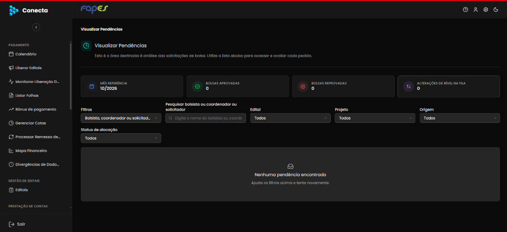
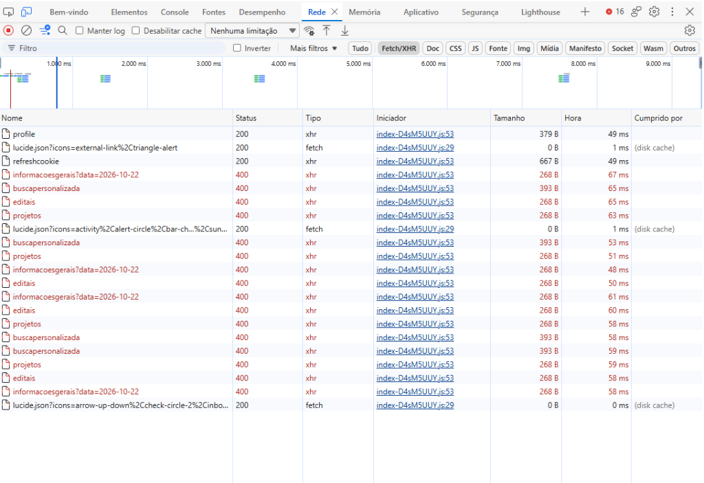
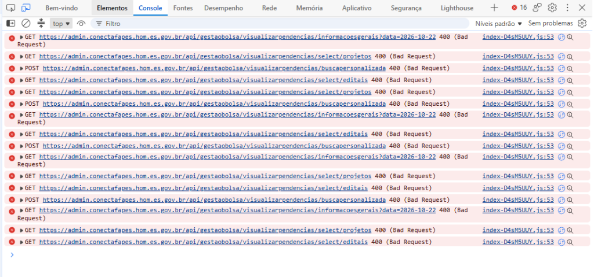

## Título
[Bug] Erro 400 (Bad Request) em múltiplos endpoints impede o carregamento da fila e indicadores em Visualizar Pendências

## ID
BUG-M009-BO-BOLS-001

## Requisito/Regra Violada
- Regra Canônica: M009 (Gestão de Bolsistas) — Visualização, triagem e indicadores da fila de pendências de bolsas e alterações de nível pela Área Técnica FAPES. A tela deve carregar os dados consolidados do mês de referência, os filtros de busca e a listagem de pendências ativas.
- Rota/Componente: `/gestao-bolsa/visualizar-pendencias` (Backoffice Admin)
- Endpoints com falha:
  - `GET /api/gestaobolsa/visualizarpendencias/informacoesgerais?data=2026-10-22`
  - `GET /api/gestaobolsa/visualizarpendencias/select/projetos`
  - `GET /api/gestaobolsa/visualizarpendencias/select/editais`
  - `POST /api/gestaobolsa/visualizarpendencias/buscapersonalizada`

## Ambiente
[ ] Produção  [ ] Staging  [x] Homologação

## Dispositivo/SO
Windows 11 / Google Chrome / Backoffice Admin (Vue 3 / Nuxt UI)

## Gravidade/Prioridade
[x] 🔴 Bloqueante  [ ] 🟠 Alta  [ ] 🟡 Média  [ ] 🟢 Baixa

## Passo a Passo
1. Acessar o Portal Administrativo do Conecta FAPES no ambiente de Homologação (`https://admin.conectafapes.hom.es.gov.br`).
2. Efetuar login com usuário autorizado (Analista FAPES / Administrador).
3. Navegar até o menu de **Visualizar Pendências** (`/gestao-bolsa/visualizar-pendencias`).
4. Abrir as ferramentas de desenvolvedor (F12) nas abas **Console** e **Rede (Network)**.
5. Observar o processamento das requisições disparadas automaticamente na inicialização da página e o estado da tela.

## Dados de Entrada
- Rota acessada: `/gestao-bolsa/visualizar-pendencias`
- Parâmetro de query enviado: `data=2026-10-22`
- Sessão: Autenticada com sucesso (`profile` e `refreshcookie` retornando HTTP 200)

## Comportamento Esperado
- As requisições à API sob `/api/gestaobolsa/visualizarpendencias/` devem retornar HTTP 200 (OK):
  - `informacoesgerais`: Deve fornecer o consolidado de bolsas aprovadas, reprovadas e alterações de nível na fila para o mês de referência.
  - `select/editais` e `select/projetos`: Devem carregar as opções para os filtros de busca.
  - `buscapersonalizada`: Deve retornar a lista de solicitações de bolsas (novas alocações e alterações de nível) aguardando avaliação.
- A tela deve exibir os indicadores populados e os cards das pendências disponíveis para análise.

## Comportamento Atual
- Todos os endpoints de negócio da tela falham imediatamente com **HTTP 400 (Bad Request)**.
- O console do navegador exibe múltiplos erros de requisição rejeitada disparados pelo bundle frontend (`index-D4sM5UUY.js:53`).
- Os indicadores de topo permanecem com valor zero (`Bolsas Aprovadas: 0`, `Bolsas Reprovadas: 0`, `Alterações de Nível na Fila: 0`).
- Os filtros por projeto e edital não são preenchidos.
- A listagem principal exibe o estado vazio (*"Nenhuma pendência encontrada - Ajuste os filtros acima e tente novamente."*), bloqueando por completo a triagem e avaliação dos bolsistas pelos analistas.

## Evidências
- 📷 Screenshots / Vídeos:
  - 
  - 
  - 
- 🧾 Logs / Retorno da API:
  - `GET https://admin.conectafapes.hom.es.gov.br/api/gestaobolsa/visualizarpendencias/informacoesgerais?data=2026-10-22 -> 400 (Bad Request)` (268 B)
  - `GET https://admin.conectafapes.hom.es.gov.br/api/gestaobolsa/visualizarpendencias/select/projetos -> 400 (Bad Request)` (268 B)
  - `GET https://admin.conectafapes.hom.es.gov.br/api/gestaobolsa/visualizarpendencias/select/editais -> 400 (Bad Request)` (268 B)
  - `POST https://admin.conectafapes.hom.es.gov.br/api/gestaobolsa/visualizarpendencias/buscapersonalizada -> 400 (Bad Request)` (393 B)

## Sugestão de Investigação
- Como a autenticação e cookies de sessão (`profile` e `refreshcookie`) estão respondendo HTTP 200 com sucesso, a falha reside na validação dos parâmetros ou modelo de requisição dos endpoints do controller `VisualizarPendenciasController` (backend .NET):
  1. **Validação do formato de data:** Verificar se o endpoint `informacoesgerais` espera a data em formato específico (ex.: `yyyy-MM-dd`, `dd/MM/yyyy`, ou se houve incompatibilidade com timezone/cultura no parsing do parâmetro `data=2026-10-22`).
  2. **Contrato de Busca Personalizada (`POST buscapersonalizada`):** Inspecionar se o body enviado pelo frontend está aderente ao DTO atual do backend. Mudanças recentes para suporte a filtro de "Alteração de Nível" (conforme card #3024 / #2550) podem ter alterado campos obrigatórios, enums ou validações FluentValidation.
  3. **Rotas de Select (`/select/projetos` e `/select/editais`):** Avaliar se esses endpoints exigem algum query parameter adicional (ex.: `ano`, `modalidade`, `contexto`) que não está sendo enviado pelo frontend após o último deploy de homologação.
  4. Inspecionar o log de aplicação no backend (SigNoz/Grafana/logs do container) para coletar o corpo da mensagem de erro e a exception exata gerada no `BadRequestObjectResult`.
