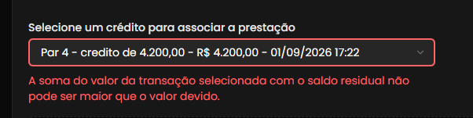
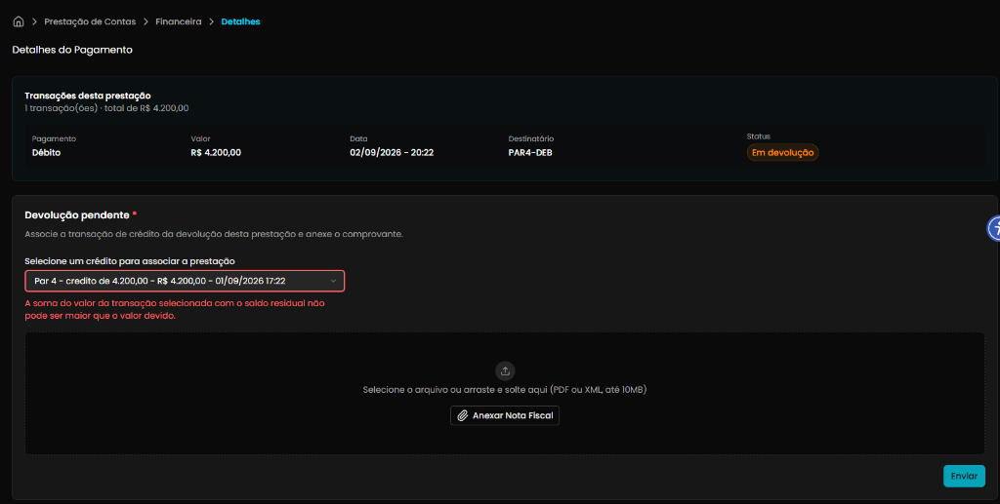

## Título
[Bug] Mensagem indevida de saldo residual maior que o devido ao associar crédito de devolução de mesmo valor ao débito

## ID
BUG-M014-FO-PREST-008

## Requisito/Regra Violada
- Regra Canônica:
  - M014 / M013: `RN02` (Conciliação de despesas e transações financeiras) e `RN11` / `RN13` (Associação e compensação entre créditos e débitos / Devoluções)
  - `EPIC-M014-013` (Devoluções do Coordenador)
  - `US-M014-052` (Associar Devolução a Compra ou Prestação)
  - `US-M014-053` (Exibir Saldo Residual da Compra — Devolução Integral com saldo residual R$ 0,00)
- Heurísticas de Usabilidade de Nielsen:
  - **Heurística #5 (Prevenção de Erros)**: Falso positivo em regra de validação aritmética que impede a conclusão de um fluxo válido de devolução financeira integral.
  - **Heurística #9 (Ajudar usuários a reconhecer, diagnosticar e recuperar-se de erros)**: Mensagem de erro contraditória e incoerente com o estado real dos dados (*"A soma do valor da transação selecionada com o saldo residual não pode ser maior que o valor devido."*), visto que o valor devido é de R$ 4.200,00 e o crédito selecionado é de exatamente R$ 4.200,00.
  - **Heurística #3 (Controle do Usuário e Liberdade)**: Bloqueio indevido da ação de submissão da comprovação da devolução.
- Rota/Componente: `/coordenador/prestacao-financeira/detalhes/:paymentId` (`src/modules/PrestacaoContas/composables/useDevolucao.ts`)

## Ambiente
[ ] Produção  [ ] Staging  [x] Homologação

## Dispositivo/SO
Windows 11 / Chrome v120+ / Frontoffice Vue-Nuxt UI em `https://conectafapes.hom.es.gov.br`

## Gravidade/Prioridade
[x] 🔴 Bloqueante  [ ] 🟠 Alta  [ ] 🟡 Média  [ ] 🟢 Baixa

## Passo a Passo
1. Acessar o Frontoffice com perfil de Coordenador no ambiente de Homologação.
2. Navegar até o extrato de prestação em `/coordenador/financeira`.
3. Identificar e abrir uma transação de Débito com o status `Em devolução` (ex.: Débito de `R$ 4.200,00` em `/coordenador/prestacao-financeira/detalhes/:paymentId`).
4. Na seção **Devolução pendente \***, abrir a lista suspensa `Selecione um crédito para associar a prestação`.
5. Selecionar a transação de crédito correspondente de igual valor (`Par 4 - credito de 4.200,00 - R$ 4.200,00 - 01/09/2026 17:22`).
6. Observar a validação do campo e o estado de habilitação do botão de envio.

## Dados de Entrada
- Rota: `/coordenador/prestacao-financeira/detalhes/:paymentId`
- Transação da prestação: Débito de `R$ 4.200,00` (Status: `Em devolução`, Destinatário: `PAR4-DEB`, Data: `02/09/2026 - 20:22`)
- Valor devido da prestação: `R$ 4.200,00`
- Crédito selecionado: `Par 4 - credito de 4.200,00 - R$ 4.200,00 - 01/09/2026 17:22` (Valor: `R$ 4.200,00`)

## Comportamento Esperado
- Como o crédito selecionado (`R$ 4.200,00`) possui valor idêntico ao débito devido (`R$ 4.200,00`), a operação configura uma **devolução integral perfeita**, resultando em saldo residual de `R$ 0,00`.
- O sistema deve aceitar a seleção sem acusar inconsistência de limites.
- O campo não deve exibir borda vermelha nem mensagem de erro.
- O botão `Enviar` deve permanecer disponível para submissão após o anexo do comprovante.

## Comportamento Atual
- Ao selecionar a transação de crédito de igual valor ao débito, o campo fica com borda vermelha e exibe a mensagem impeditiva:
  > **"A soma do valor da transação selecionada com o saldo residual não pode ser maior que o valor devido."**
- A validação no frontend realiza uma soma incoerente entre o valor do crédito selecionado e o saldo residual inicial (`4.200,00 + 4.200,00 = 8.400,00`), concluindo falsamente que o total excede o valor devido (`8.400,00 > 4.200,00`).
- A flag `creditoSelecionadoExcedeValorDevido` bloqueia o envio da comprovação (`envioBloqueado = true`), impedindo o coordenador de concluir o processo de devolução.

## Evidências
- 📷 **Mensagem de erro indevida abaixo do dropdown de crédito:**
  

- 📷 **Tela de Detalhes do Pagamento com transação de débito e crédito de R$ 4.200,00:**
  

## Sugestão de Investigação
- Inspecionar a computada `creditoSelecionadoExcedeValorDevido` em `src/modules/PrestacaoContas/composables/useDevolucao.ts` (linhas 111-119):
  ```typescript
  const creditoSelecionadoExcedeValorDevido = computed(() => {
    const creditoSelecionado = creditoOptions.value.find(option => option.id === fields.creditoId.value.value)
    const devolucao = deps.prestacao.value?.devolucao
    if (!creditoSelecionado || !devolucao) return false

    const totalEmCentavos = Math.round((creditoSelecionado.valor + devolucao.saldoResidual) * 100)
    const valorDevidoEmCentavos = Math.round(devolucao.valorDevido * 100)
    return totalEmCentavos > valorDevidoEmCentavos
  })
  ```
- **Causa provável do falso positivo:**
  - O código está somando `creditoSelecionado.valor` ao `devolucao.saldoResidual`. Como no início do fluxo o `saldoResidual` ainda é igual ao `valorDevido` (R$ 4.200,00), a soma resulta em `4.200,00 + 4.200,00 = 8.400,00`, superando `valorDevido` (`4.200,00`).
  - **Correção sugerida:**
    1. Validar se o crédito selecionado excede o saldo que ainda resta a ser devolvido:
       `creditoSelecionado.valor > devolucao.saldoResidual` (com margem de tolerância em centavos se necessário);
       **OU**
    2. Somar o crédito selecionado aos valores *já devolvidos/vinculados previamente* (`valorDevolvidoAnterior + creditoSelecionado.valor > valorDevido`).
