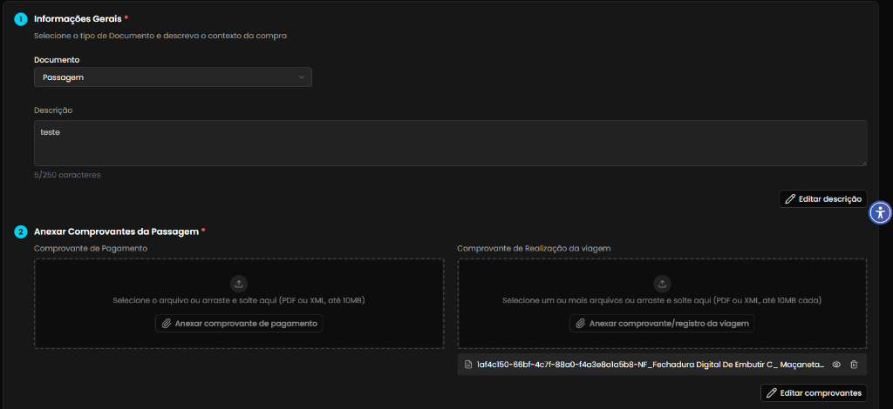
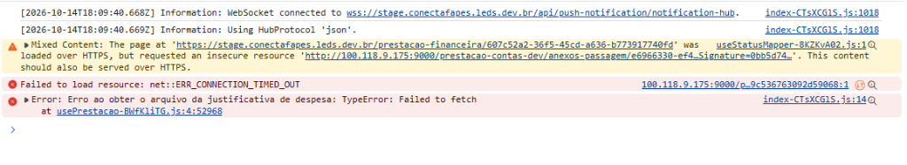

## Título
[Bug] Comprovante de Pagamento da Passagem não é exibido ao carregar despesa devido a erro de Mixed Content e timeout ao buscar arquivo no storage

## ID
BUG-M014-FO-PAS-015

## Requisito/Regra Violada
- Fluxo/Contexto: Comprovação de Débito de Passagem — **Seção 2 (Anexar Comprovantes da Passagem)**
- Regra Canônica:
  - M014 / M013: `RN02` (Conciliação Extrato x Despesa) e `ConsultarPrestacaoContas` (Visualização agregada da prestação, justificativas e seus comprovantes anexados).
  - M014: `RN05` / `RN12` (Obrigatoriedade, integridade e guarda do comprovante de pagamento bancário da passagem e comprovante de realização de viagem).
- Heurísticas de Usabilidade de Nielsen:
  - **Heurística #1 (Visibilidade do Status do Sistema)**: A interface omite completamente o `Comprovante de Pagamento` já cadastrado, mantendo o dropzone vazio (*"Selecione o arquivo ou arraste e solte aqui"*), transmitindo a percepção enganosa de que o comprovante foi apagado ou não foi anexado.
  - **Heurística #9 (Ajudar usuários a reconhecer, diagnosticar e recuperar-se de erros)**: As falhas de `Mixed Content`, `net::ERR_CONNECTION_TIMED_OUT` e `TypeError: Failed to fetch` ocorrem no console sem nenhum aviso amigável, indicador de falha ou opção de tentar novamente para o usuário na interface.
- Casos de Teste Relacionados: `CT-M014-FO-051` (anexar comprovante de pagamento da passagem), `CT-M014-FO-130` (editar e substituir o anexo de comprovante de pagamento da passagem).
- Defeito Correlato no Módulo: `BUG-M014-FO-INV-008` (Mesma falha estrutural de storage / Mixed Content no fluxo de Invoice).
- Rota/Componente: `/coordenador/prestacao-financeira/:id` (`DetalhesPrestacao.vue`, `usePrestacao.ts`, `DetalhesPrestacaoPassagemComprovantesSection.vue`)
- Endpoint / Recurso Afetado:
  - `GET /api/prestacao-de-contas/projeto/:projetoId/justificativa-despesa/passagem/:id/presigned-url`
  - URL gerada pelo storage: `http://100.118.9.175:9000/prestacao-contas-dev/anexos-passagem/...`

## Ambiente
[ ] Produção  [x] Staging  [ ] Homologação

## Dispositivo/SO
Windows 11 / Chrome / Frontoffice Vue-Nuxt UI em `https://stage.conectafapes.leds.dev.br`

## Gravidade/Prioridade
[ ] 🔴 Bloqueante  [x] 🟠 Alta  [ ] 🟡 Média  [ ] 🟢 Baixa

## Passo a Passo
1. Acessar o Frontoffice no ambiente de Staging (`https://stage.conectafapes.leds.dev.br`) com o perfil de Coordenador.
2. Navegar para a Prestação de Contas Financeira e abrir uma transação de débito do tipo **Passagem** que já possua a Seção 2 cadastrada (ex.: rota `/prestacao-financeira/607c52a2-36f5-45cd-a636-b773917740fd`).
3. Observar a exibição da **Seção 2 (Anexar Comprovantes da Passagem *)**, especificamente o campo **Comprovante de Pagamento**.
4. Abrir as Ferramentas de Desenvolvedor (`F12`) e inspecionar os logs na aba Console.

## Dados de Entrada
- Ambiente: Staging (`https://stage.conectafapes.leds.dev.br`)
- Rota: `/prestacao-financeira/607c52a2-36f5-45cd-a636-b773917740fd`
- Tipo de documento: Passagem
- Seção 1 (Informações Gerais): Documento `Passagem`, Descrição `teste`
- Seção 2 (Comprovante de Realização): Exibido normalmente (`1af4c150-66bf-4c7f-88a0-f4a3e8a1a5b8-NF_Fechadura Digital De Embutir C_ Maçaneta...`)
- Seção 2 (Comprovante de Pagamento): Vazio na tela
- URL insegura gerada pelo storage: `http://100.118.9.175:9000/prestacao-contas-dev/anexos-passagem/e6966330-ef4...`

## Comportamento Esperado
- Ao abrir a despesa de Passagem com a Seção 2 já cadastrada, a aplicação deve obter com sucesso o arquivo do Comprovante de Pagamento via URL HTTPS pública e segura.
- O campo `Comprovante de Pagamento` deve exibir o arquivo previamente anexado com seu nome, tamanho e ações de visualização/edição, assim como ocorre com o Comprovante de Realização da viagem.
- Nenhum erro de Mixed Content, timeout de conexão ou falha de fetch deve ser disparado no console.

## Comportamento Atual
- O `Comprovante de Pagamento` não é exibido na tela, permanecendo com o campo de upload vazio (*"Selecione o arquivo ou arraste e solte aqui (PDF ou XML, até 10MB)"*).
- No console do navegador são registrados erros críticos:
  - `Mixed Content: The page at 'https://stage.conectafapes.leds.dev.br/prestacao-financeira/607c52a2-36f5-45cd-a636-b773917740fd' was loaded over HTTPS, but requested an insecure resource 'http://100.118.9.175:9000/prestacao-contas-dev/anexos-passagem/e6966330-ef4...Signature=0bb5d74...'. This content should also be served over HTTPS.`
  - `Failed to load resource: net::ERR_CONNECTION_TIMED_OUT` para `100.118.9.175:9000`
  - `Error: Erro ao obter o arquivo da justificativa de despesa: TypeError: Failed to fetch at usePrestacao-BWfK1iTG.js:4:52968`

## Evidências
- 📷 **Tela da Passagem com Comprovante de Pagamento ausente (campo vazio) na Seção 2:**  
  

- 📷 **Console do navegador registrando Mixed Content, ERR_CONNECTION_TIMED_OUT e falha de fetch:**  
  

## Sugestão de Investigação
- **Configuração de Endpoint do MinIO / S3 no Backend em Staging:**
  - O serviço backend em Stage está gerando presigned URLs com o IP privado interno do cluster (`http://100.118.9.175:9000/prestacao-contas-dev/anexos-passagem/...`) usando protocolo HTTP inseguro.
  - O navegador bloqueia a requisição por Mixed Content (a aplicação roda em HTTPS: `https://stage.conectafapes.leds.dev.br`) e a rede externa do cliente não consegue alcançar o IP 100.118.9.175 (`ERR_CONNECTION_TIMED_OUT`).
  - Configurar no MinIO/S3 a variável de endpoint externo público com HTTPS (ex.: `S3__EXTERNAL_ENDPOINT` apontando para o domínio ou proxy seguro) para que as URLs de download de anexos de passagem sejam resolvidas por HTTPS e acessíveis externamente.
- **Tratamento no Frontend (`usePrestacao.ts`):**
  - No watcher de `justificativaId` em `usePrestacao.ts` (linhas 342-353), o método `createFileFromArquivoResponse(pagamentoResponse)` faz `fetch` direto na URL retornada. Ao ocorrer falha de rede/Mixed Content, a exceção é lançada e o estado `filePagamento` permanece `undefined` sem nenhuma indicação visual de erro para o usuário.
